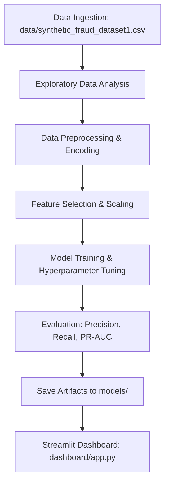

# Financial Fraud Detection System

An end-to-end Machine Learning solution designed to detect fraudulent financial transactions in real-time, built with Python, scikit-learn, and Streamlit.

---

## 📌 Project Overview

Financial fraud poses a severe threat to financial institutions, payment gateways, and end users. This project focuses on building an intelligent fraud detection pipeline capable of identifying suspicious transaction behavior, minimizing false positives, and providing interactive risk analytics through a Streamlit dashboard.

### 🎯 Key Objectives

1. **Exploratory Data Analysis (EDA):** Uncover behavioral patterns, transaction volume distributions, and class imbalances in financial transactions.
2. **Feature Engineering & Preprocessing:** Encode categorical attributes (transaction type, device, location, merchant category, card brand), scale numerical values, and extract temporal features.
3. **Machine Learning Modeling:** Train and evaluate classification algorithms (e.g., Logistic Regression, Random Forest, Gradient Boosting / XGBoost) optimized for imbalanced classification metrics (Precision, Recall, F1-Score, ROC-AUC).
4. **Interactive Dashboard:** Provide financial analysts with an intuitive Streamlit interface to inspect transaction risks, visualize fraud trends, and test live transaction predictions.

---

## 📁 Repository Structure

```text
Fraud_Detection_System/
│
├── data/
│   └── synthetic_fraud_dataset1.csv   # Primary dataset for analysis & training
│
├── notebooks/                         # Jupyter notebooks for EDA and experimentation
│
├── src/                               # Modular Python source code
│   ├── __init__.py
│   ├── data_loader.py                 # (Planned) Data loading and validation routines
│   ├── preprocessing.py               # (Planned) Feature transformation and scaling
│   └── model_utils.py                 # (Planned) Training, evaluation, and serialization
│
├── dashboard/                         # Streamlit application files
│   └── app.py                         # (Planned) Interactive dashboard application
│
├── models/                            # Saved model weights and preprocessing pipelines
│
├── .gitignore                         # Git exclusion rules
├── README.md                          # Project documentation
└── requirements.txt                   # Project dependencies
```

---

## 📊 Dataset Details

- **File Path:** `data/synthetic_fraud_dataset1.csv`
- **Total Records:** 50,001 transactions
- **Target Variable:** `Fraud_Label` (`0` = Legitimate transaction, `1` = Fraudulent transaction)

### Key Attributes:
- **Identifier Features:** `Transaction_ID`, `User_ID`
- **Financial Metrics:** `Transaction_Amount`, `Account_Balance`
- **Behavioral Indicators:** `Daily_Transaction_Count`, `Previous_Fraudulent_Activity`
- **Contextual Features:** `Transaction_Type`, `Device_Type`, `Location`, `Merchant_Category`, `Card_Type`, `Card_Age`, `Date`

---

## 🛠️ Planned Workflow



1. **Phase 1: Ingestion & EDA** (`notebooks/`):
   - Inspect missing values, anomalies, and target class distribution.
   - Analyze fraud rates across merchant categories, device types, and transaction amounts.
2. **Phase 2: Preprocessing & Feature Engineering** (`src/`):
   - Standardize numerical features and encode high-cardinality categorical variables.
   - Handle target class imbalance (e.g., SMOTE, class weights, or threshold tuning).
3. **Phase 3: Model Training & Evaluation** (`src/`, `models/`):
   - Train baseline and advanced ensemble classifiers.
   - Benchmark models prioritizing precision-recall balance and ROC-AUC.
   - Serialize production-ready models into `models/`.
4. **Phase 4: Streamlit Dashboard Deployment** (`dashboard/`):
   - Real-time transaction risk scoring simulator.
   - High-level KPIs and interactive fraud monitoring charts.

---

## 🚀 Setup & Installation

### 1. Prerequisites
- Python 3.9+ (Python 3.10 or 3.11 recommended)
- `pip` package manager

### 2. Clone the Repository & Navigate to Project
```bash
cd "d:/Madhura's Projects/Zedio Developments/Fraud_Detection_System"
```

### 3. Set Up a Virtual Environment
```bash
# Windows (PowerShell)
python -m venv venv
.\venv\Scripts\Activate.ps1
```

### 4. Install Dependencies
```bash
pip install -r requirements.txt
```

---

## 🖥️ How to Run

### Run Jupyter Notebooks (EDA / Experimentation)
```bash
jupyter notebook notebooks/
```

### Run the Streamlit Dashboard (Once Implemented)
```bash
streamlit run dashboard/app.py
```

---

## 📌 Project Status

- [x] Project structure initialization
- [x] Environment and dependency configuration (`requirements.txt`)
- [x] Git ignore configuration (`.gitignore`)
- [x] Dataset verification (`data/synthetic_fraud_dataset1.csv`)
- [x] Exploratory Data Analysis (EDA)
- [x] Preprocessing and feature engineering pipeline
- [x] Model training and evaluation
- [x] Streamlit interactive dashboard development
